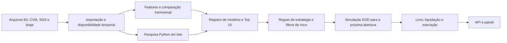

# Relatório de implementação ORFEU

Ambiente local em 24/11/2026. PHP CLI 7.4.33 em `C:\xampp\php\php.exe`, Python 3.12.10, MariaDB 10.4.27 e Apache XAMPP na porta 8090. O schema `orfeu` existia e estava vazio. O acesso de desenvolvimento usa a conta `root` local conforme solicitado. A consulta administrativa ao catálogo de usuários revelou um erro de índice em `mysql.global_priv`. As consultas ao ORFEU e o DDL funcionaram. A instalação está em [http://localhost:8090/trade_orfeu/public/](http://localhost:8090/trade_orfeu/public/).

| Verificação local | Resultado observado |
| --- | --- |
| Migrations 001–005 | 28 tabelas de aplicação e 1 journal. Segunda inspeção em dry-run retornou zero pendências. |
| Calendário inicial | 365 dias de 2026, incluindo fechamentos e sessão especial de Cinzas. |
| Catálogo inicial | 10 ações candidatas, todas em acompanhamento. |
| Temporada `season-001` | 15 contas com R$ 1.000 cada. Repetição criou 0 contas. Reconciliação registrou 15 contas e 0 divergências. |
| Testes locais | 22 casos PHP e 5 casos Python passaram. O teste de paridade usa fixture sintética. Sintaxe PHP e JavaScript conferidas. |
| Rotas do XAMPP | HTTP 200 nas rotas GET do painel e API. Acesso a `.env`, `app/` e `storage/` retornou 403. A solicitação `mode=LIVE` retornou 400. |
| Job EOD | `BLOCKED_EOD_DATA` por falta de barras oficiais importadas. |
| Replay e features históricos | `BLOCKED_NO_POINT_IN_TIME_EOD`. |

## Fontes e cobertura efetiva

| Fonte | Cobertura observada e estado |
| --- | --- |
| brapi v1 sem token | Uma cotação observada para PETR4, VALE3 e ITUB4 cada. As sete restantes seguem sem cotação no painel, conforme limitação da coleta anônima. A autenticação usa Bearer. Cobertura e direitos dos planos autenticados dependem do contrato. |
| CVM ITR 2026 | 25 documentos e 3.959 observações normalizadas para sete emissores com código CVM no catálogo inicial. DFP disponível pelo mesmo importador. |
| SGS/BCB, série 12 | 13 observações de CDI para a consulta de 02/11/2026 a 24/11/2026. Valores em percentual diário. |
| B3 COTAHIST | Layout oficial conferido. A tentativa de obter o arquivo anual por endereço de distribuição recebeu 403; no outro endereço oficial testado, o ZIP veio vazio. A execução diária aguarda um arquivo oficial válido. |
| Benchmarks | CDI presente na janela da coleta. Ibovespa ainda depende de importação. |
| Previsões por 1D, 5D e 20D | Nenhuma prevista com dados reais nesta execução. A seleção está em `SEED_UNVALIDATED`. Intraday de 30/60 minutos indisponível. |
| Ordens, fills e métricas históricas | Zero ordens e fills de mercado simulados. Invariantes são validados em fixtures; resultados de mercado dependem de dados e de avaliação independente. |

A B3 descreve cotações históricas brutas, sem ajuste por proventos, desde 1986. A página do produto proíbe coleta automatizada; a FAQ da B3 orienta solicitar dados históricos não expostos no site a distribuidores autorizados. Assim, este ambiente precisa receber um arquivo obtido manualmente sob autorização ou credenciais/licença UP2DATA/distribuidor antes do backfill. Armazenamento e exibição na hospedagem devem respeitar o contrato. [Cotações históricas B3](https://www.b3.com.br/pt_br/market-data-e-indices/servicos-de-dados/market-data/historico/mercado-a-vista/cotacoes-historicas/) · [FAQ UP2DATA e distribuidores autorizados](https://b3.com.br/pt_br/market-data-e-indices/servicos-de-dados/up2data/perguntas-frequentes/) · [Layout COTAHIST](https://www.b3.com.br/data/files/33/67/B9/50/D84057102C784E47AC094EA8/SeriesHistoricas_Layout.pdf) · [Calendário 2026](https://www.b3.com.br/pt_br/noticias/calendario-de-negociacao-da-b3-confira-o-funcionamento-da-bolsa-em-2026.htm) · [Dados ITR da CVM](https://dados.cvm.gov.br/dataset/cia_aberta-doc-itr) · [Planos brapi](https://brapi.dev/pricing).

## Execução e componentes

- `app/Market.php`, `Sources.php`, `Store.php` e `Research.php` implementam calendário, contratos de dados, importadores e armazenamento point-in-time.
- `app/Quant.php` e `Pipeline.php` implementam features, inferência, score, limite de dez, limite por setor/emissor e avaliação diária.
- `app/Trading.php` e `Replay.php` implementam contas independentes, ordens EOD, reservas, fills, liquidação, marcação e execução em pesquisa.
- O sinal `QUALITY_VALUE` passou a usar margem operacional e margem líquida trimestrais da CVM, disponíveis no instante da decisão. A tela o identifica como qualidade operacional; não calcula valuation nem permite promoção só com esse sinal.
- O replay informa retorno anualizado e volatilidade por conta; anualização e Calmar ficam indisponíveis quando falta marcação válida em algum pregão da janela.
- `public/`, `app/Http.php` e `app/Admin.php` oferecem o painel, API, exportação CSV e controles administrativos opcionais.
- `python/orfeu_quant/` oferece montagem do painel, maturidade de labels, holdout e folds walk-forward purgados e sem sobreposição, baseline linear, challenger LightGBM nos mesmos folds, agregação média/desvio das métricas e inferência JSON. A avaliação real depende dos dados B3 ainda não importados.
- `python/orfeu_quant/metrics.py` também valida curvas e CDI e calcula retorno anualizado, volatilidade anualizada e Calmar, além de cobertura e Sharpe excedente.
- `bin/orfeu.php` expõe instalação, manutenção, dados, pesquisa e jobs. `bin/tick-hostgator.sh` e `bin/tick-windows.ps1` permitem configurar o agendamento conforme o ambiente.

Comandos executados incluem `doctor`, `migrate --dry-run`, `migrate`, `calendar:seed`, `universe:seed`, `season:create --name=season-001 --capital=1000`, `data:quotes --sandbox`, `data:bcb --series=12 --from=2026-11-02 --to=2026-11-24`, `data:cvm --file=storage/inbox/itr_cia_aberta_2026.zip`, `rank:refresh`, `reconcile`, `tick --dry-run`, `tick --once`, `research:export`, `research:features`, `backtest`, `tests/run.php` e `python -m unittest discover -s tests/python -v`.

## Pendências de operação e do escopo ampliado

- **Histórico e ciência.** Importar COTAHIST, calendários históricos, catálogo contemporâneo com deslistadas, Ibovespa e cobertura societária. O código de walk-forward já existe, mas rodadas com dados reais, OOS/prospectivo e promoção continuam pendentes. O conjunto disponível não sustenta métricas preditivas.
- **Estratégias.** As 15 contas foram registradas. Cinco estratégias de especialidade continuam bloqueadas por falta de intraday, consenso publicado, payout histórico, modelo macro validado ou meta-modelo OOF. Qualidade operacional usa margens CVM recentes, sem ajuste setorial nem valuation. As demais compartilham a barreira de dados, edge e validação.
- **Execução e pesquisa ampliadas.** Faltam livro intraday, ordens limite, tributação, frações societárias e séries reais completas de retorno total. A fábrica declarativa e os diagnósticos de monitoramento já existem; integração operacional do monitor ainda depende de janelas persistidas e labels maduros. A bateria de invariantes foi ampliada, mas não cobre todos os casos da especificação.
- **HostGator.** Perfil cPanel, separação da área pública, Cron e PHP independente de Python foram preparados. A publicação e a validação na hospedagem dependem do ambiente do usuário. Nenhuma tarefa persistente foi instalada automaticamente.

Veja [operação, implantação e rollback](OPERATIONS.md), [dicionário](DATA_DICTIONARY.md), [pesquisa](RESEARCH_PROTOCOL.md), [execução](B3_EXECUTION_ASSUMPTIONS.md) e [segurança](SECURITY.md).

## Quant Intelligence V3 increment - 2026-11-26

### Files and database

- Added `python/orfeu_quant/intelligence.py`: pair evaluation (Engle-Granger, ADF,
  Johansen, CUSUM, FDR, Kalman, Z-score, and half-life), Long-Only research signals,
  point-in-time multifactor ranking, momentum, mean reversion, carry, BSM reference,
  order-book diagnostics, regime, and risk.
- Added `tests/python/test_intelligence.py` and `docs/QUANT_INTELLIGENCE_V3.md`.
- `app/Quant.php`, `app/Http.php`, `public/dashboard.php`, and
  `public/assets/orfeu.js` expose backend readiness for nine strategy families and a
  partial CVM quality snapshot. The endpoint is `/api/v1/quant/intelligence`.
- `python -m orfeu_quant.intelligence` scans a hashed ORFEU point-in-time export, runs
  pair tests only when 252 synchronized COTAHIST sessions and verified identities exist,
  applies FDR, and writes a report without overwriting an existing file.
- Installed `.[quant,test]` in `.venv`: NumPy 2.5.5, SciPy 1.18.1, scikit-learn 1.9.1,
  Statsmodels 0.15.0, pandas 3.1.1, pytest 9.2.0, and Ruff 0.17.6. LightGBM is still
  optional and absent; XGBoost, HDBSCAN, and VectorBT are not installed.
- The initial Quant Intelligence increment needed no migration; existing additive
  migrations 006-010 were applied after
  a database dump at `storage/backups/orfeu-before-quant-20261126.sql`. The fixed
  watchlist was seeded without replacing accounts or ledger entries. `migrate --dry-run`
  now reports no pending steps. The database still has 15 accounts, zero orders, and
  zero fills.
- Follow-up risk audit added and applied migration 011 (`orf_risk_event`). The paper
  pipeline now records idempotent per-account/per-session kill-switch, daily-loss, and
  season-pause events; policy limits default to 10% peak drawdown and 3% daily loss and
  can be overridden without rewriting existing seasons. Health API/dashboard exposes
  the latest events. The current database has none because no portfolio history breaches
  can be observed.

### Measured state

After migration 011, `doctor` reported schema `orfeu`, MariaDB 10.4.27, 35 tables, 365
sessions, 10 watchlist symbols, 3 quotes, **0 EOD bars**, 15 accounts, 0 orders, and 0
fills. `reconcile` returned 15 accounts and 0 mismatches. Dashboard and Quant endpoint
returned 9 families, `dynamic_rotation=false`, `live_trading_enabled=false`, and
A hashed research run is now registered in `orf_research_run`:
`7dbbfc8b5e3025312dbe0e05e3fd5c11cbbcbef033f79d08ce318d485006b889`. It used export
`5b172ff56b185dee8035e4f978b9352e498651fa39315fca0d14c18e57b50e91`, found zero EOD
bars and zero pair candidates, and returned `BLOCKED_NO_EOD_DATA`. The model trainer on
that real export returned `BLOCKED_INSUFFICIENT_DATA / NO_MATURE_LABELS / samples=0`.
CVM ITR observations available by the cutoff support seven partial operating/net-margin
snapshots for 2026-09-30. They are shown separately in the dashboard and are not a
multifactor score or a ranking of the fixed basket.

Validation completed: 33/33 PHP cases; four factory/scheduler integration scenarios;
prediction-evaluation integration; and 53 Python unittest cases with one explicit skip
because the LightGBM runtime is unavailable. Pytest reports 52 passed and one skipped.
Ruff reports no findings on the Python modules. Pair-statistics, drift, and risk-metric
tests use isolated synthetic fixtures and are not strategy evidence. PHP/JavaScript
syntax, `git diff --check`, dashboard API, Quant and health APIs, `doctor`, migration
dry-run, and ledger reconciliation were checked.

### Remaining V3 limits

The nine modules appear in the dashboard with requirements and status, but not all are
connected to execution accounts; none of the 15 account identifiers was changed. Pair
tests have Statsmodels installed, but actual evaluation still needs point-in-time bars.
Historical B3/COTAHIST imports and calendars, Ibovespa history, verified corporate-action
coverage, verified research-universe identities, comprehensive point-in-time fundamentals,
option chains, futures, and
order-book history remain unavailable. Consequently, out-of-sample metrics, full
tradability verification, confirmed official fees, expanded tournament, real-series
VaR/CVaR, ML calibration, crisis stress tests, and any return claims remain pending.
See [Quant Intelligence V3](QUANT_INTELLIGENCE_V3.md).

The factor ranking now groups correlated measures (for example P/E with earnings yield)
before assigning factor weights, to reduce duplicate influence. The added Python metric
helpers cover aligned strategy/benchmark return series, beta,
annualized arithmetic alpha, tracking error, information ratio, Sharpe, Sortino,
realized-trade win rate, profit factor, expectancy, and seeded IID/circular-block
bootstrap distributions for return and drawdown. They are verified only with synthetic
fixtures because the database has no market-bar or trade history.

The latest research increment adds point-in-time PCA/DBSCAN cross-sectional grouping and
BIC-selected Gaussian-mixture regime diagnostics. The ML trainer now accepts
`--random-forest` and `--xgboost` for separate calibrated challengers on its purged
train/calibration/test folds; XGBoost reports `BLOCKED_DEPENDENCY` in this environment,
and neither challenger can be promoted from synthetic fixtures. HDBSCAN and GARCH expose
the same explicit dependency-block behavior until optional runtimes and valid series exist.
The Long-Only swing diagnostic now covers breakout/pullback, volume, ATR stops, time exits,
and capped order sizing; it schedules candidate entries for the next session only.
The validated OHLCV indicator pack adds ADX, MACD, Bollinger bands, RSI, ATR, EMA distance,
and abnormal-volume ratio for use by those analytical filters.
Covariance-based Risk Parity and HRP calculators now return normalized research weights
only when a dated, positive-semidefinite covariance matrix is supplied.

### Input drift diagnostics increment - 2026-11-26

Added `python/orfeu_quant/monitoring.py` and `tests/python/test_monitoring.py` for
point-in-time feature drift checks with PSI, a two-sample KS diagnostic, explicit
missing-rate reporting, and matured-label quality checks with Brier score and calibration
gap. Review thresholds are heuristics. The routines cannot retrain, promote, rotate, or
trade. Integration with persisted mature feature windows remains pending; current data
coverage does not support a live alert. Full Python validation now reports 53 unittest
cases and 52 pytest passes, with the
existing optional LightGBM skip; Ruff passes across `python/orfeu_quant` and
`tests/python`.

### Declarative strategy specification increment - 2026-11-26

`python/orfeu_quant/factory.py` now accepts `ORFEU_STRATEGY_SPEC_V1` JSON for a bounded
single-family parameter grid, development folds, reserved holdout, seed, and trial budget.
The parser rejects unknown fields, expressions, invalid values, and overlapping temporal
windows. The existing CLI form remains supported, and holdout replay still runs once at
normal and stressed costs only after the development candidate is frozen. Python
validation now reports 53 unittest cases and 52 pytest passes, with the optional
LightGBM test skipped; Ruff and `git diff --check` pass.

### Ledger and risk invariant coverage increment - 2026-11-26

Extended `tests/run.php` with checks for the aggregate sector budget, a zero aggregate-risk
gate, and `PaperAccount::matchesLedger` across pending and filled states. The checks also
mutate cash and position cost in isolated fixtures to ensure reconciliation rejects
inconsistent totals. The PHP suite now reports 33/33 passing; this expands targeted
coverage but does not claim to exhaust every invariant in the V3 specification.

### Benchmark uncertainty and cross-sectional IC increment - 2026-11-26

`python/orfeu_quant/metrics.py` now includes paired circular-block bootstrap intervals
for aligned strategy/benchmark returns and daily cross-sectional Spearman IC. The linear
trainer attaches IC diagnostics to its out-of-sample return metrics; sessions with fewer
than three assets are omitted, and fewer than two valid cross sections remain explicitly
blocked. The bootstrap preserves pairing and short-run blocks and reports empirical
intervals conditional on the supplied sample. These methods have synthetic-fixture
coverage only: there are no real EOD bars or strategy fills in the current database.
Validation now reports 53 Python unittest cases and 52 pytest passes (one optional
LightGBM skip), 33/33 PHP cases, Ruff clean, and `git diff --check` clean.

### Out-of-sample feature ablation increment - 2026-11-27

The linear trainer now computes repeated within-session permutation ablation on each
out-of-sample fold for return MAE and calibrated Brier scores. It records per-feature
mean and standard deviation deltas, and marks the results as research-only and excluded
from selection. Correlated inputs can mask one another; this is not causal attribution
or retrain-per-feature ablation. The synthetic test confirms the report shape and OOS
integration. Full Python validation now reports 53 unittest cases and 52 pytest passes,
with the optional LightGBM test skipped, and Ruff passes.

### Meta-label walk-forward completion - 2026-11-27

Extended the research-only meta-label CLI to run purged walk-forward OOF folds before a
separate reserved holdout. The embargo is derived from the latest label-end session;
feature availability must be no later than signal decision time, and test outcomes must
be mature by `as_of`. The run reports fold metrics and holdout comparison to a historical
frequency baseline, without exporting a model or selecting from holdout performance.
The end-to-end CLI test exercises the full flow on synthetic fixtures; no real signal
export exists. Full Python validation remains 53 unittest cases and 52 pytest passes,
with the optional LightGBM case skipped.

### Causal corporate-action return series increment - 2026-11-27

Added `python/orfeu_quant/returns.py` for raw-price buy-and-hold equity curves with net
cash distributions and splits. It refuses adjusted prices, incomplete or out-of-cutoff
coverage, announcements published after the ex-date open, misaligned action dates, and
fractional split outcomes without cash-in-lieu evidence. Distributions remain cash and
are not reinvested. Four tests cover dividend counting, split continuity, lineage, and
blocking conditions. No real corporate-action series is present, so this has not produced
historical benchmark results. Full Python validation now reports 53 unittest cases and
52 pytest passes, with the optional LightGBM test skipped.

### Point-in-time stat-arb feature snapshot - 2026-11-27

Added `stat_arb_feature_snapshot` with the 16 requested return, volatility, volume,
relative-strength, pair, beta, technical, and liquidity features. It selects only raw,
hashed stock and benchmark bars available by the cutoff, synchronizes sessions, excludes
future revisions, and requires verified identity. Pair fields are joined only from a
same-session report available by the cutoff. It cannot train or trade. Two synthetic
tests cover the feature contract, identity gate, and future-revision exclusion. Full
validation reports 55 Python unittest cases, 54 pytest passes and one optional
LightGBM skip; Ruff passes and the PHP suite reports 33/33.

### Completion estimate and remaining acceptance criteria - 2026-11-27

Estimated implementation coverage is approximately 75% of the original prompt's
requested code, controls, and research tooling. Paper-only operation, account and ledger
preservation, core execution/risk constraints, research modules, temporal safeguards,
and local automated checks are implemented. The remaining share is concentrated in
evidence-dependent acceptance: licensed 10-15-year raw history and corporate actions,
verified issuer identities and historical universe membership, Ibovespa/derivative/
intraday data, real cost schedules, mature primary-signal outcomes, repeated OOS and
crisis validation, and deployment credentials. The environment currently has zero EOD
bars; no market performance or model quality claim can be established from fixtures.

### Score composto, GARCH e auditoria dos critérios - 2026-11-27

`opportunity_score` implementa os sete pesos prescritos para a escala experimental 0-100,
bloqueando componentes ausentes, booleanos ou fora da faixa. O resultado é classificado
como pesquisa e não como probabilidade de sucesso. `garch_volatility` agora ajusta
GARCH(1,1) por máxima verossimilhança Gaussiana, com persistência estritamente menor
que 1; SciPy foi declarado no extra `quant` e em `requirements.in`.

Validação atual após essas alterações: 55 pytest passaram, um teste opcional de
LightGBM foi pulado, 33/33 testes PHP passaram e Ruff passou. Os testes estatísticos
usam fixtures sintéticas. O score composto ainda não recebeu séries reais.

| Critério de aceite do prompt | Estado | Evidência ou lacuna atual |
| --- | --- | --- |
| 1. Nove famílias de estratégia incorporadas | Parcial | Nove famílias aparecem no backend e painel; módulos analíticos existem, mas integração/validação operacional depende de dados próprios de cada família. |
| 2. Estratégias incompatíveis com Long-Only desabilitadas | Atendido | Flags de venda descoberta, alavancagem, derivativos e rotação permanecem falsas; testes PHP cobrem modos proibidos. |
| 3. Contas e históricos preservados | Atendido | 15 contas existentes reconciliadas, sem divergências; migrations incrementais, sem reset de livro. |
| 4. Sinais com dados reais point-in-time | Bloqueado por dados | Regras de disponibilidade estão implementadas; banco segue com zero barras EOD e identidade pendente para os dez símbolos. |
| 5. Operações simuladas com custos | Parcial | Custos e preenchimento são aplicados no motor e em testes; não há operações históricas reais no banco para comprovar resultados. |
| 6. Modelos avaliados fora da amostra | Parcial | Purging, embargo, calibração e holdout existem; faltam labels e barras reais para avaliação empírica. |
| 7. Ranking com base quantitativa | Parcial | Ranking multifatorial, previsão/edge e score composto existem; não há cobertura real suficiente para pontuar a cesta. |
| 8. Risco capaz de bloquear operações | Atendido | Limites por posição, setor, risco agregado e kill-switch auditável; suíte PHP inclui casos de bloqueio. |
| 9. Comparação contra benchmarks históricos | Parcial | Métricas e bootstrap pareado implementados; CDI pontual existe, mas série histórica do Ibovespa ainda não foi importada. |
| 10. Dashboard com dados reais do backend | Parcial | Painel lê estado e readiness do backend e expõe ausência de dados; os rankings, curvas e heatmaps solicitados não podem ser preenchidos atualmente. |
| 11. Testes automatizados passam | Atendido | 55 pytest passam, 1 skip explicitamente opcional e 33/33 testes PHP passam; Ruff sem achados. |
| 12. Nenhuma ordem real transmissível | Atendido | PAPER_TRADING_ONLY e flags de execução real desabilitadas, com teste de rejeição de modo LIVE. |

Este quadro separa implementação de módulos e provas com mercado. A conclusão integral
continua exigindo as evidências listadas em “Pendências de operação e do escopo ampliado”;
nenhuma fixture foi tratada como desempenho real.

### Score, GARCH and pair-report visibility - 2026-11-27

The V3 score now combines the seven specified normalized components with the requested
weights and blocks missing or invalid inputs. The Gaussian GARCH(1,1) MLE is implemented
with the stationary constraint `alpha + beta < 1`; SciPy is declared as a quant extra.
The dashboard now shows the ten pair-test records from the latest point-in-time hashed
research report, including p-value, FDR q-value, dynamic Z-score and half-life, while
preserving blocked statuses.

Verification after these changes: 55 pytest passed, one optional LightGBM test skipped,
33/33 PHP tests passed, Ruff clean, PHP and JavaScript syntax valid. The local dashboard
API returned HTTP 200 with zero EOD bars, ten pair-test records, and `live_trading_enabled`
false. The zero-bar state prevents any claim of market validation.

### Point-in-time tournament comparison and factor timestamp correction - 2026-11-27

Added `python/orfeu_quant/tournament.py`: it selects a single common B3-session window
for independently funded accounts and five required benchmark curves, rebases accounts
created at different times, excludes revisions unavailable at the cutoff, and blocks
missing costs, inputs, benchmarks or sessions. It reports CAGR, volatility, drawdown,
Calmar, Sharpe/Sortino, alpha/beta and aligned comparisons, without enabling trading.
Two synthetic tests cover later-created accounts, future revisions, missing costs,
missing benchmarks and a gap in the common window. The real tournament remains blocked
because account trade histories and the required benchmark series are not present.

The multifactor ranker now parses availability timestamps in UTC and keeps only the
latest revision per symbol visible at the cutoff; offset-equivalent timestamps no longer
change eligibility. The output retains its selected `available_at` for audit.

### Validation and completion-estimate clarification - 2026-11-27

The 75% estimate refers to implemented software, safeguards, and research interfaces; it is
not a claim that 75% of market evidence or acceptance proof is complete. The explicit
12-item acceptance table currently has five fully met, six partial, and one blocked item.
With each item weighted equally and partial counted as half, that evidence checklist is
about 67% complete. It remains separate from the implementation estimate because most
partial items are waiting on historical data rather than missing calculation code.

Latest full validation after the tournament and UTC timestamp changes: 58 pytest passed,
one optional LightGBM test skipped, Ruff passed, and the PHP suite passed 33/33. The
COTAHIST acquisition blocker is now tied to B3's current published terms: its public
history page prohibits automated collection, and its FAQ directs customers to authorized
distributors for historical products not exposed on the site. The system awaits an
authorized dataset or credentials; it does not scrape that page.

### Tournament CLI completion and current verification - 2026-11-27

The common-window tournament has an executable CLI for versioned JSON inputs, stores a
SHA-256 of the exact source bytes in its report, and refuses to overwrite an existing
report. The end-to-end synthetic test verifies the report schema/hash and overwrite
protection. The data pipeline remains blocked until all five benchmark levels and
cost-inclusive account curves are supplied.

This is the latest test count and supersedes earlier totals in this report: 59 pytest
passed, 1 optional LightGBM test skipped, Ruff passed, PHP `tests/run.php` passed 33/33,
PHP syntax passed for the changed API/dashboard files, JavaScript syntax passed, and
`git diff --check` found no whitespace errors. Five upstream Statsmodels warnings remain
in the isolated pair-statistics fixture; they do not change the passing test result.

### Point-in-time correlation heatmap - 2026-11-27

Added `correlation_heatmap` to the research scan and latest-report API. It requires at
least 60 synchronized returns for every fixed symbol, raw B3 COTAHIST closes with
source hashes, verified identity, and observations available by the report cutoff. The
calculation selects the latest eligible revision, rejects invalid prices, clamps only
floating-point roundoff to the Pearson range, and labels the output
`RAW_CLOSE_PRICE; CORPORATE_ACTIONS_NOT_ADJUSTED`. It remains analytical and cannot
create trades. The dashboard now renders a colored matrix when evidence is complete and
shows the blocked state otherwise; the current report remains blocked because identity
and COTAHIST history are absent.

Validation: full Python suite 61 passed and one optional LightGBM test skipped; Ruff
passed; PHP suite 33/33; PHP and JavaScript syntax checks passed. Five existing
Statsmodels warnings remain in one isolated statistical fixture. The synthetic matrix
test verifies synchronized returns, perfect linear correlation, explicit corporate-action
caveat, and the missing-symbol gate. Local market data was not used as performance
proof.
