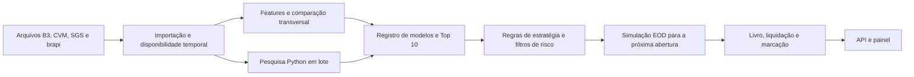

# Relatório de implementação ORFEU

Ambiente local em 24/11/2026. PHP CLI 7.4.33 em `C:\xampp\php\php.exe`, Python 3.12.10, MariaDB 10.4.27 e Apache XAMPP na porta 8090. O schema `orfeu` existia e estava vazio. O acesso de desenvolvimento usa a conta `root` local conforme solicitado. A consulta administrativa ao catálogo de usuários revelou um erro de índice em `mysql.global_priv`. As consultas ao ORFEU e o DDL funcionaram. A instalação está em [http://localhost:8090/trade_orfeu/public/](http://localhost:8090/trade_orfeu/public/).

| Verificação local | Resultado observado |
| --- | --- |
| Migrations 001–005 | 28 tabelas de aplicação e 1 journal. Segunda inspeção em dry-run retornou zero pendências. |
| Calendário inicial | 365 dias de 2026, incluindo fechamentos e sessão especial de Cinzas. |
| Catálogo inicial | 10 ações candidatas, todas em acompanhamento. |
| Temporada `season-001` | 15 contas com R$ 1.000 cada. Repetição criou 0 contas. Reconciliação registrou 15 contas e 0 divergências. |
| Testes locais | 22 casos PHP e 5 casos Python passaram. O teste de paridade usa fixture sintética. Sintaxe PHP e JavaScript conferidas. |
| Rotas do XAMPP | HTTP 200 nas rotas GET do painel e API. Acesso a `.env`, `app/` e `storage/` retornou 403. A solicitação `mode=LIVE` retornou 400. |
| Job EOD | `BLOCKED_EOD_DATA` por falta de barras oficiais importadas. |
| Replay e features históricos | `BLOCKED_NO_POINT_IN_TIME_EOD`. |

## Fontes e cobertura efetiva

| Fonte | Cobertura observada e estado |
| --- | --- |
| brapi v1 sem token | Uma cotação observada para PETR4, VALE3 e ITUB4 cada. As sete restantes seguem sem cotação no painel, conforme limitação da coleta anônima. A autenticação usa Bearer. Cobertura e direitos dos planos autenticados dependem do contrato. |
| CVM ITR 2026 | 25 documentos e 3.959 observações normalizadas para sete emissores com código CVM no catálogo inicial. DFP disponível pelo mesmo importador. |
| SGS/BCB, série 12 | 13 observações de CDI para a consulta de 02/11/2026 a 24/11/2026. Valores em percentual diário. |
| B3 COTAHIST | Layout oficial conferido. A tentativa de obter o arquivo anual por endereço de distribuição recebeu 403; no outro endereço oficial testado, o ZIP veio vazio. A execução diária aguarda um arquivo oficial válido. |
| Benchmarks | CDI presente na janela da coleta. Ibovespa ainda depende de importação. |
| Previsões por 1D, 5D e 20D | Nenhuma prevista com dados reais nesta execução. A seleção está em `SEED_UNVALIDATED`. Intraday de 30/60 minutos indisponível. |
| Ordens, fills e métricas históricas | Zero ordens e fills de mercado simulados. Invariantes são validados em fixtures; resultados de mercado dependem de dados e de avaliação independente. |

A B3 descreve cotações históricas brutas, sem ajuste por proventos. O armazenamento e a exibição na hospedagem devem respeitar os termos do fornecedor. Uso público e redistribuição não foram autorizados ou confirmados para este ambiente. [Layout COTAHIST](https://www.b3.com.br/data/files/33/67/B9/50/D84057102C784E47AC094EA8/SeriesHistoricas_Layout.pdf) · [Calendário 2026](https://www.b3.com.br/pt_br/noticias/calendario-de-negociacao-da-b3-confira-o-funcionamento-da-bolsa-em-2026.htm) · [Dados ITR da CVM](https://dados.cvm.gov.br/dataset/cia_aberta-doc-itr) · [Planos brapi](https://brapi.dev/pricing).

## Execução e componentes

- `app/Market.php`, `Sources.php`, `Store.php` e `Research.php` implementam calendário, contratos de dados, importadores e armazenamento point-in-time.
- `app/Quant.php` e `Pipeline.php` implementam features, inferência, score, limite de dez, limite por setor/emissor e avaliação diária.
- `app/Trading.php` e `Replay.php` implementam contas independentes, ordens EOD, reservas, fills, liquidação, marcação e execução em pesquisa.
- `public/`, `app/Http.php` e `app/Admin.php` oferecem o painel, API, exportação CSV e controles administrativos opcionais.
- `python/orfeu_quant/` oferece montagem do painel, maturidade de labels, split purgado, baseline, challenger, métricas e inferência JSON.
- `bin/orfeu.php` expõe instalação, manutenção, dados, pesquisa e jobs. `bin/tick-hostgator.sh` e `bin/tick-windows.ps1` permitem configurar o agendamento conforme o ambiente.

Comandos executados incluem `doctor`, `migrate --dry-run`, `migrate`, `calendar:seed`, `universe:seed`, `season:create --name=season-001 --capital=1000`, `data:quotes --sandbox`, `data:bcb --series=12 --from=2026-11-02 --to=2026-11-24`, `data:cvm --file=storage/inbox/itr_cia_aberta_2026.zip`, `rank:refresh`, `reconcile`, `tick --dry-run`, `tick --once`, `research:export`, `research:features`, `backtest`, `tests/run.php` e `python -m unittest discover -s tests/python -v`.

## Pendências de operação e do escopo ampliado

- **Histórico e ciência.** Importar COTAHIST, calendários históricos, catálogo contemporâneo com deslistadas, Ibovespa e cobertura societária. Treino com dados reais, walk-forward completo, OOS/prospectivo e promoção continuam pendentes. O conjunto disponível não sustenta métricas preditivas.
- **Estratégias.** As 15 contas foram registradas. Seis estratégias de especialidade dependem de implementações adicionais para intraday, fundamentos setoriais, surpresa publicada, payout, fatores macro ou modelo meta. As demais compartilham a barreira de dados, edge e validação.
- **Execução e pesquisa ampliadas.** Faltam livro intraday, ordens limite, tributação, frações societárias, séries de retorno total completas, fábrica declarativa de estratégias, rotinas completas de drift e a bateria integral de invariantes da especificação.
- **HostGator.** Perfil cPanel, separação da área pública, Cron e PHP independente de Python foram preparados. A publicação e a validação na hospedagem dependem do ambiente do usuário. Nenhuma tarefa persistente foi instalada automaticamente.

Veja [operação, implantação e rollback](OPERATIONS.md), [dicionário](DATA_DICTIONARY.md), [pesquisa](RESEARCH_PROTOCOL.md), [execução](B3_EXECUTION_ASSUMPTIONS.md) e [segurança](SECURITY.md).
